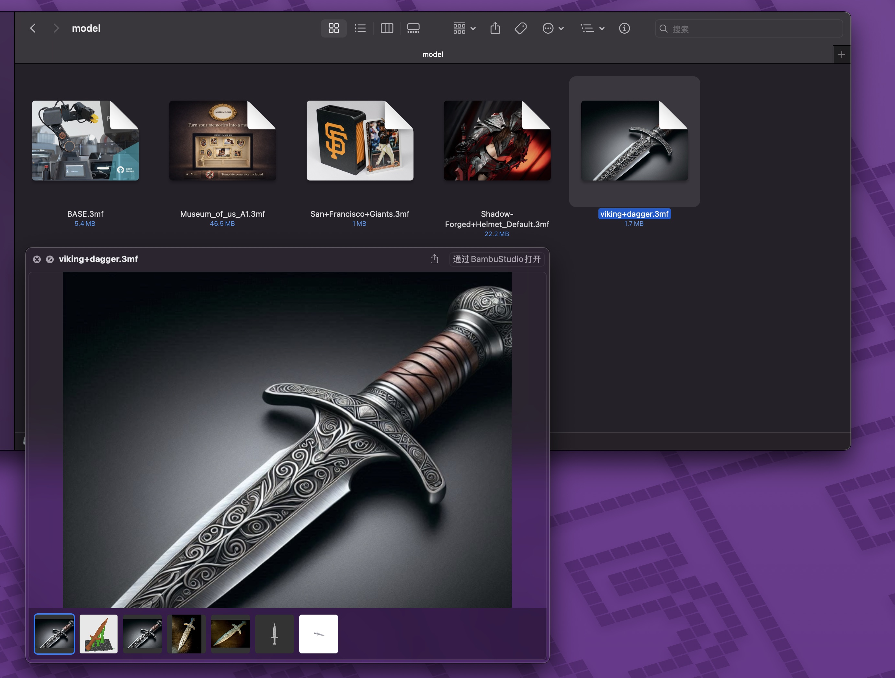

# 3MF Thumbnail

A macOS Quick Look plugin that adds Finder thumbnails and 3D model preview for `.3mf` (3D Manufacturing Format) files.



## Features

- **Finder Thumbnails** — See 3MF file previews directly in Finder
- **Quick Look Preview** — Press Space to preview embedded thumbnails and interactive 3D models
- **Multi-object Support** — Browse multiple thumbnails and models within a single 3MF file
- **3D Interaction** — Rotate, zoom, and pan 3D models in the preview

## Requirements

- macOS 12.0 (Monterey) or later
- [XcodeGen](https://github.com/yonaskolb/XcodeGen) (for building from source)

## Install

### Download

1. Download `3MF-Thumbnail.dmg` from [Releases](https://github.com/eyestudio/3MF-Thumbnail/releases)
2. Drag `3MF Thumbnail.app` to `/Applications`
3. Open the app once to register the extensions

### Build from Source

```bash
git clone https://github.com/eyestudio/3MF-Thumbnail.git
cd 3MF-Thumbnail
xcodegen generate
xcodebuild -project "3MF Thumbnail.xcodeproj" -scheme "3MF Thumbnail" -configuration Release build
bash deploy.sh
```

## Tech Stack

- **Swift** + Quick Look Extensions (`QLThumbnailProvider`, `QLPreviewingController`)
- **SceneKit** for 3D model rendering
- **ZIPFoundation** for 3MF archive extraction
- **XcodeGen** for project generation

## License

MIT
